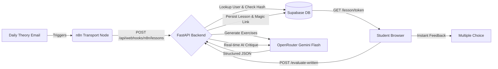

# AI-Driven German Exercise Platform — Backend (`language_exercises`)

[](https://www.python.org/)
[](https://fastapi.tiangolo.com/)
[](https://docs.pydantic.dev/)
[](https://supabase.com/)
[](https://openrouter.ai/)

An asynchronous FastAPI backend engineered to ingest daily German theory emails from n8n, generate pedagogical exercises via OpenRouter (`google/gemini-2.5-flash`), persist them to Supabase PostgreSQL, and serve capability-based ephemeral links to students with zero login friction.

---

## 📚 Documentation Index

Explore the complete system architecture, database design, API contracts, and integration guides:

| Document | Description |
| :--- | :--- |
| **[🏗️ System Architecture & Flow](docs/architecture.md)** | End-to-end data flow, Zero-Auth model, capability tokens, idempotency ledger, and Mermaid sequence diagrams. |
| **[📡 API Reference](docs/api_reference.md)** | Comprehensive specifications for all HTTP endpoints, query params, schemas, status codes, and security headers. |
| **[🤖 AI Generation & Evaluation Engine](docs/ai_engine.md)** | OpenRouter integration with Gemini 2.5 Flash, prompts structure, JSON extraction & validation, and written evaluation. |
| **[🗄️ Database Architecture & Schema](docs/database_schema.md)** | Supabase PostgreSQL tables (`users`, `subscriptions`, `exercises`, `answers`, `magic_links`, `lesson_ingestions`), ERD, constraints, and indexes. |
| **[⚙️ Configuration & Environment](docs/configuration.md)** | Separation of secrets (`.env`) vs parameters (`app.yaml`, `ai.yaml`, `prompts.yaml`), and settings loading. |
| **[👤 User Registration & Management](docs/user_registration.md)** | Step-by-step SQL guides for registering, activating, and managing student course subscriptions. |
| **[⚡ Lesson Ingestion Webhook](docs/exercises_webhook.md)** | Transport contract, cURL/Python/JS client examples, background tasks, and status handling. |

---

## 🚀 How the System Works



### 1. Ingestion & Automated Provisioning
* **n8n as Pure Transport:** n8n extracts recipient email and raw lesson text and posts to `POST /api/webhooks/n8n/lessons`.
* **Zero Token Waste:** If an email is received for an unregistered user, the backend auto-provisions them with `is_active = FALSE` and skips AI generation.
* **Idempotency:** Computes a SHA-256 hash of email + course + text. Re-sending identical text returns the existing lesson without burning AI tokens.

### 2. Pedagogical Exercise Generation
* OpenRouter (`google/gemini-2.5-flash`) extracts a concise `theory_summary` and generates:
  * **Multiple-Choice Exercises:** Evaluated 100% client-side with 0 ms latency using pre-calculated per-option explanations.
  * **Written Exercises:** Open-ended prompts evaluated dynamically by the AI in real time when the student submits.
* Assigns canonical, sequential lesson numbers (`lesson = MAX(lesson) + 1`).

### 3. Ephemeral Capability Magic Links
* Generates a 64-character URL-safe capability token (`secrets.token_urlsafe(32)`).
* URL delivered to student: `http://localhost:5173/lesson/{token}`.
* Token expires automatically after a configurable timespan (default: 7 days). Expired access safely responds with `HTTP 410 Gone`.

---

## 🛠️ Tech Stack & Key Libraries

* **Framework:** [FastAPI](https://fastapi.tiangolo.com/) with asynchronous event loops.
* **Validation:** [Pydantic V2](https://docs.pydantic.dev/) for strict payload validation and response models.
* **Database:** [Supabase](https://supabase.com/) (PostgreSQL) with relational constraints and indexing.
* **AI Provider:** [OpenRouter](https://openrouter.ai/) calling `google/gemini-2.5-flash`.
* **HTTP Client:** [HTTPX](https://www.python-httpx.org/) for async communication with AI APIs.
* **Configuration:** [PyYAML](https://pyyaml.org/) + `pydantic-settings`.
* **Package Management:** [Poetry](https://python-poetry.org/).

---

## ⚙️ Configuration Structure

Secrets and application parameters are strictly decoupled across dedicated files:

```
language_exercises/
├── .env                  # Sensitive secrets (API keys, DB credentials)
└── config/
    ├── app.yaml          # Server host/port, CORS, magic link lifespan, courses
    ├── ai.yaml           # Model name, temperatures, max tokens, timeouts, retries
    └── prompts.yaml      # Version-controlled system & user prompt templates
```

For configuration details, see [⚙️ Configuration Guide](docs/configuration.md).

---

## ⚡ Quickstart & Local Development

### 1. Prerequisites
* Python 3.11+
* Poetry installed (`pip install poetry`)
* A Supabase project (or local PostgreSQL instance)

### 2. Installation
```powershell
# Navigate to backend directory
cd language_exercises

# Install dependencies via Poetry
python -m poetry install
```

### 3. Setup Secrets (`.env`)
Create `.env` based on `.env.example`:
```ini
SUPABASE_URL=https://your-project.supabase.co
SUPABASE_KEY=your-supabase-service-role-or-anon-key
OPENROUTER_API_KEY=sk-or-v1-your-openrouter-key
N8N_API_KEY=your-internal-n8n-secret-api-key
```

### 4. Setup Database Schema
Execute the SQL script [`sql/schema.sql`](sql/schema.sql) in your **Supabase SQL Editor**. See [🗄️ Database Architecture & Schema](docs/database_schema.md) for table details.

### 5. Start Development Server
```powershell
python -m poetry run uvicorn app.main:app --reload --host 0.0.0.0 --port 8000
```
* **Interactive API Documentation:** Open `http://localhost:8000/docs`.
* **Health Check:** `http://localhost:8000/health`.

### 6. Run Test Suite
```powershell
python -m poetry run python tests/test_backend.py
```

---

## 🔌 Core API Endpoints

| Method | Endpoint | Description | Auth |
| :--- | :--- | :--- | :--- |
| `POST` | `/api/webhooks/n8n/lessons` | Ingests theory email & generates lesson | `X-API-Key` |
| `GET` | `/api/lesson/{token}` | Resolves capability magic link token | Token in path |
| `POST` | `/api/exercises/evaluate-written` | Dynamic AI evaluation of written answers | None / Token |
| `POST` | `/api/answers/record` | Records submitted answer into database | None |
| `GET` | `/api/user/{email}/latest-lesson`| Zero-auth resolution for latest student lesson | Email in path |
| `GET` | `/health` | System health and configuration telemetry | None |

For full request/response schemas, see [📡 API Reference](docs/api_reference.md).

---

## 📂 Project Directory Layout

```
language_exercises/
├── app/
│   ├── api/
│   │   └── routes/          # API route handlers (webhooks, lessons, exercises, answers)
│   ├── core/                # Configuration loader (config.py) and security verification
│   ├── db/                  # Supabase PostgreSQL client and repositories
│   ├── schemas/             # Pydantic V2 schemas (exercise, api, db)
│   ├── services/            # Core business logic (lesson_service.py, ai_service.py)
│   └── main.py              # FastAPI application factory and middleware
├── config/                  # Declarative YAML configuration (app.yaml, ai.yaml, prompts.yaml)
├── docs/                    # Architectural, API, and Integration documentation
│   ├── ai_engine.md
│   ├── api_reference.md
│   ├── architecture.md
│   ├── configuration.md
│   ├── database_schema.md
│   ├── exercises_webhook.md
│   └── user_registration.md
├── requirements/            # Detailed requirements specification (base.md)
├── sql/                     # PostgreSQL database migration scripts (schema.sql)
├── tests/                   # End-to-end backend test suite
├── .env.example             # Example environment secrets
├── pyproject.toml           # Poetry project dependencies
└── README.md                # Project home and documentation hub
```