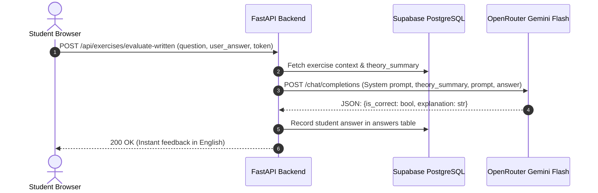

# AI Generation & Dynamic Evaluation Engine

[🏠 Home (README)](../README.md) • [🏗️ Architecture](architecture.md) • [📡 API Reference](api_reference.md) • [🤖 AI Engine](ai_engine.md) • [🗄️ Database](database_schema.md) • [⚙️ Configuration](configuration.md) • [👤 User Management](user_registration.md) • [⚡ Ingestion Webhook](exercises_webhook.md)

---

## 1. Engine Overview

The AI Engine in `language_exercises` is powered by **OpenRouter API** leveraging Google's **Gemini 2.5 Flash** (`google/gemini-2.5-flash`). It is designed around two core responsibilities:

1. **Batch Lesson Generation (Asynchronous Ingestion):** Takes raw, unstructured email text and converts it into a concise `theory_summary` along with a list of typed interactive exercises (`multiple_choice` with per-option explanations, and `written` prompts).
2. **Dynamic Runtime Written Evaluation (Live Student Submission):** Evaluates open-ended student text submissions on demand, providing real-time grammatical and syntactic critiques in English while highlighting correct German phrasing.

---

## 2. Model & Service Configuration

AI parameters are configured via `config/ai.yaml` and loaded into Pydantic models:

```yaml
openrouter:
  base_url: "https://openrouter.ai/api/v1"
  model: "google/gemini-2.5-flash"
  timeout_seconds: 45
  max_retries: 3
  site_url: "https://german-exercises.local"
  site_name: "German AI Exercises"

generation:
  temperature: 0.2    # Low temperature for strict schema adherence and reliable grammar
  max_tokens: 3500

evaluation:
  temperature: 0.1    # Extremely low temperature for strict, deterministic grammar evaluation
  max_tokens: 800
```

---

## 3. Lesson Generation Workflow

When an incoming raw email is processed by `app.services.lesson_service.LessonService`, it delegates exercise generation to `app.services.ai_service.AIService.generate_lesson`.

### 3.1. Prompt Engineering (`config/prompts.yaml`)

#### System Prompt
Instructs the AI to act as a German pedagogue and enforce JSON schema compliance:
* Creates a high-yield `theory_summary` extracting grammar patterns, preposition usages, and vocabulary.
* For `multiple_choice` exercises:
  - Generates 3 to 4 plausible choices.
  - Exactly one option has `is_correct: true`.
  - **Crucial Rule:** Every single option must provide a comprehensive `explanation`. The correct option explains the rule; the incorrect options explain why they fail and what rule was violated.
* For `written` exercises:
  - Provides a prompt in `question` (e.g. translation, rephrasing, case-ending transformation).
  - Explicitly leaves `options`, `expected_answer`, and `explanation` empty.

#### JSON Output Enforcement
The API payload sets:
```json
{
  "response_format": { "type": "json_object" }
}
```
And prompts request pure JSON without conversational intro/outro text.

### 3.2. Robust JSON Extraction & Repair
Large Language Models occasionally wrap outputs in markdown code fences (` ```json ... ``` `) or include leading newlines. The `_extract_json` method sanitizes responses using regular expressions before parsing:

```python
def _extract_json(self, raw_content: str) -> Dict[str, Any]:
    cleaned = raw_content.strip()
    fence_match = re.search(r"```(?:json)?\s*([\s\S]*?)\s*```", cleaned)
    if fence_match:
        cleaned = fence_match.group(1).strip()
    return json.loads(cleaned)
```

### 3.3. Pydantic V2 Schema Validation
Parsed JSON is passed through `GeneratedLesson.model_validate(parsed_json)`. If the AI model omits a required field or returns invalid types:
1. Pydantic raises a `ValidationError`.
2. The retry loop intercepts the failure and attempts up to `openrouter_max_retries` (default: 3).
3. If all attempts fail, the error is logged and an exception is raised so the calling workflow (or n8n) is notified.

---

## 4. Dynamic Runtime Written Answer Evaluation

Unlike multiple-choice exercises whose solutions are known at generation time, written German answers are **open-ended** and evaluated at the exact second the student submits them.

### Evaluation Workflow



### Prompt Details for Written Evaluation

The evaluator receives:
1. **Theory Summary:** Context from the original lesson (e.g., Wechselpräpositionen rules).
2. **Question Prompt:** The assigned translation or sentence formation challenge.
3. **User Answer:** The student's submitted text.

The system prompt enforces:
* **Feedback Language:** English (clear, constructive, pedagogically sound).
* **If Correct (`is_correct: true`):** Validates why the phrasing and case endings are accurate; optionally notes alternative natural expressions.
* **If Incorrect (`is_correct: false`):** Identifies the exact grammatical error (e.g., used Dativ instead of Akkusativ, incorrect verb conjugation, missing umlaut) and explicitly writes the correct German sentence.

---

## 5. Offline & Development Mock Fallback

To support local testing, automated CI/CD pipelines, and development when an OpenRouter API key is unavailable or empty:
* If `OPENROUTER_API_KEY` is empty, starts with `your-` or `placeholder`:
  - `generate_lesson()` returns a realistic German grammar lesson on **Wechselpräpositionen** (two-way prepositions) with 3 multiple-choice exercises and 1 written exercise.
  - `evaluate_written_answer()` uses an intelligent local heuristic evaluator that inspects key grammatical tokens (e.g. `den Tisch`, `dem Tisch`) and returns realistic pedagogical feedback.
* This guarantees that local frontend and backend development can proceed seamlessly without burning API credits.

---

## 6. Next Steps & Related Documentation

* [🏗️ System Architecture](architecture.md) — High-level architecture and sequence flows.
* [📡 API Reference](api_reference.md) — HTTP endpoints and payload documentation.
* [🗄️ Database Schema](database_schema.md) — Supabase PostgreSQL tables and relationships.
* [⚙️ Configuration Guide](configuration.md) — YAML configuration files and environment secrets.
