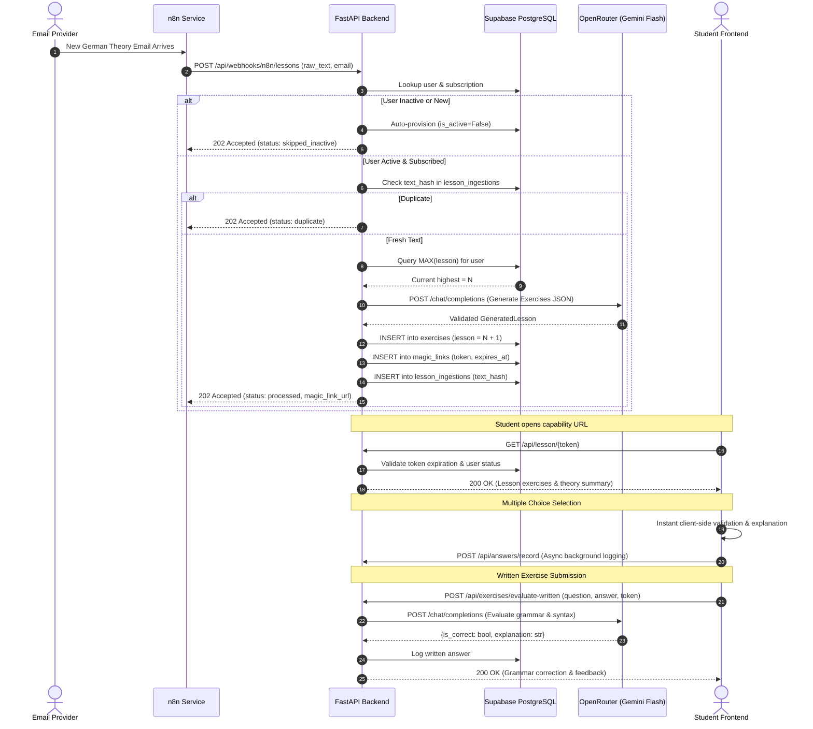

# System Architecture & Design

[🏠 Home (README)](../README.md) • [🏗️ Architecture](architecture.md) • [📡 API Reference](api_reference.md) • [🤖 AI Engine](ai_engine.md) • [🗄️ Database](database_schema.md) • [⚙️ Configuration](configuration.md) • [👤 User Management](user_registration.md) • [⚡ Ingestion Webhook](exercises_webhook.md)

---

## 1. Executive Summary

The **AI-Driven German Exercise Platform Backend** (`language_exercises`) is a lightweight, asynchronous Python service built with **FastAPI** and **Pydantic V2**. Its primary responsibility is transforming unformatted theoretical German lesson emails into pedagogically structured, interactive exercises, persisting them in a **Supabase (PostgreSQL)** database, and serving them securely without requiring usernames or passwords.

### High-Level Architecture Diagram

```mermaid
flowchart TD
    subgraph Ingestion ["1. Daily Ingestion"]
        Email[Daily German Theory Email] -->|Triggers| n8n[n8n Workflow]
        n8n -->|POST /api/webhooks/n8n/lessons<br/>Raw text + Email + X-API-Key| FastAPI[FastAPI Backend]
    end

    subgraph CoreEngine ["2. Processing & Generation"]
        FastAPI --> AuthCheck{Active User & Subscribed?}
        AuthCheck -->|No| AutoProv[Auto-provision Inactive<br/>Skip AI generation]
        AuthCheck -->|Yes| Idempotency{Check Text Hash<br/>Already ingested?}
        Idempotency -->|Duplicate| SkipDup[Return 202 Duplicate]
        Idempotency -->|New| OpenRouter[OpenRouter API<br/>google/gemini-2.5-flash]
        OpenRouter -->|Pydantic V2 Validation| LessonGen[GeneratedLesson:<br/>Theory Summary + Exercises]
        LessonGen --> DBWrite[(Supabase PostgreSQL)]
        DBWrite --> GenToken[Generate Ephemeral Magic Link<br/>token_urlsafe 32]
    end

    subgraph StudentAccess ["3. Student Experience"]
        Student([Student Browser]) -->|GET /lesson/{token}| FastAPI
        FastAPI --> TokenCheck{Valid & Unexpired?}
        TokenCheck -->|Valid| Deliver[Serve Lesson & Exercises]
        TokenCheck -->|Expired| HTTP410[HTTP 410 Gone / Expired]
        
        Deliver --> MC[Multiple Choice:<br/>Client-side instant feedback]
        Deliver --> Written[Written Exercise:<br/>POST /api/exercises/evaluate-written]
        Written --> EvalAI[OpenRouter Dynamic AI Evaluation]
        EvalAI --> Feedback[Instant grammatical explanation]
    end
```

---

## 2. Core Architectural Principles

### 2.1. Strict Separation of Concerns (n8n vs. Backend)
* **n8n (Pure Transport Layer):** n8n acts strictly as an email listener and payload transport. It extracts the raw email body and student email address and calls the backend webhook. It performs **no** AI prompting, exercise generation, or database writes.
* **Backend (`language_exercises`):** Owns all business logic, prompt engineering, sequential lesson numbering, AI model invocation, error retries, database persistence, and token issuance.

### 2.2. Zero-Auth Capability URLs (Ephemeral Magic Links)
To provide a frictionless student experience while avoiding plaintext email exposure or unauthorized access:
* Students do not log in or remember passwords.
* Each lesson run generates a cryptographically secure, high-entropy capability token (`secrets.token_urlsafe(32)`).
* The URL format is: `http://localhost:5173/lesson/{token}`.
* Magic links have a configurable lifespan (`MAGIC_LINK_TIMESPAN_DAYS`, default: 7 days).
* Validation rule:
  $$\text{valid} \iff (\text{now} \le \text{expires\_at}) \land (\text{is\_revoked} == \text{False}) \land (\text{user.is\_active} == \text{True})$$
* If an expired link is accessed, the frontend intercepts the HTTP 410 response and renders a dedicated session expiration screen.
* For backward compatibility and development, the system also supports zero-auth resolution via `GET /api/user/{email}/latest-lesson` and `GET /{email}/`.

### 2.3. Active-Only Generation & Zero Token Waste
To prevent unauthorized users or spam emails from exhausting AI tokens:
1. **Auto-Provisioning as Inactive:** When an email arrives for an unknown student, the backend creates the user with `is_active = FALSE` and creates their subscription record.
2. **Immediate Return:** Generation is skipped (`status: "skipped_inactive"`). No AI calls are dispatched and no exercises are stored.
3. **Admin Activation:** An administrator activates the user in the database (`UPDATE users SET is_active = TRUE`), after which future incoming emails will trigger exercise generation.

### 2.4. Idempotent Ingestion Ledger
Re-sending the same email text or executing duplicate n8n retries will not duplicate exercises or increment the lesson number:
* The backend computes a deterministic SHA-256 hash:
  $$\text{hash} = \text{SHA-256}(\text{email} + \text{course\_name} + \text{normalized\_raw\_text})$$
* It verifies the `lesson_ingestions` table before triggering OpenRouter.
* If a duplicate hash exists, it immediately returns `status: "duplicate"` alongside the existing lesson number.

---

## 3. Exercise Evaluation Engine Architecture

The platform splits exercises into two distinct execution strategies:

| Dimension | Multiple Choice Exercises | Written Exercises |
| :--- | :--- | :--- |
| **Storage in DB** | `question` + JSONB `options` (`text`, `is_correct`, `explanation`) | `question` + `theory_summary` (No pre-calculated answer) |
| **Evaluation Model** | 100% Client-Side Instantaneous Evaluation | Dynamic Runtime AI Evaluation |
| **Latency** | 0 ms (Zero network round-trip) | ~1.0 - 2.5s (Asynchronous AI call) |
| **API Endpoint** | Evaluated in browser; recorded via `POST /api/answers/record` | Evaluated & recorded via `POST /api/exercises/evaluate-written` |
| **Pedagogical Feedback** | Explicit explanation for both correct and incorrect options | Nuanced contextual critique highlighting errors and correct German grammar |

---

## 4. End-to-End Sequence Diagram



---

## 5. Next Steps & Related Documentation

* [📡 API Reference](api_reference.md) — Detailed contract for all HTTP endpoints.
* [🤖 AI Engine Guide](ai_engine.md) — Prompts, model configuration, and retry logic.
* [🗄️ Database Schema](database_schema.md) — PostgreSQL table definitions, keys, and indexes.
* [👤 User Management Guide](user_registration.md) — Manual & automatic student activation procedures.
* [⚡ Ingestion Webhook Guide](exercises_webhook.md) — Integrating automated email workflows or custom ingestion scripts.
