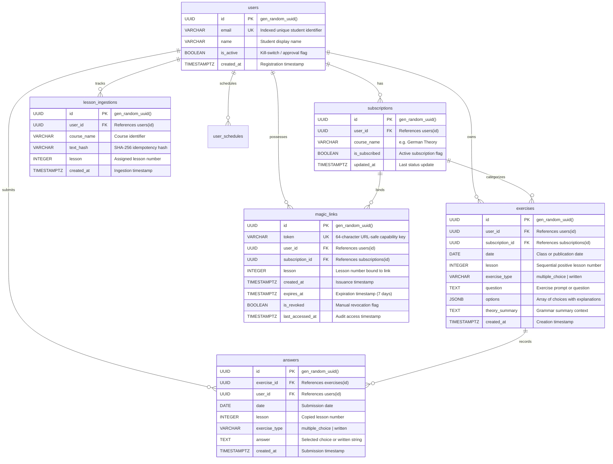

# Database Architecture & Supabase Schema

[🏠 Home (README)](../README.md) • [🏗️ Architecture](architecture.md) • [📡 API Reference](api_reference.md) • [🤖 AI Engine](ai_engine.md) • [🗄️ Database](database_schema.md) • [⚙️ Configuration](configuration.md) • [👤 User Management](user_registration.md) • [⚡ Ingestion Webhook](exercises_webhook.md)

---

## 1. Overview & Setup

The database layer runs on **PostgreSQL** hosted on **Supabase**. It provides strict relational integrity, UUID primary keys, JSONB option storage for multiple-choice exercises, composite foreign keys, and indexes for millisecond query resolution.

The database initialization script is located at:
[`sql/schema.sql`](../sql/schema.sql)

To initialize or migrate the database:
1. Open your **Supabase Dashboard**.
2. Navigate to the **SQL Editor**.
3. Paste the contents of [`sql/schema.sql`](../sql/schema.sql) and execute.

---

## 2. Entity-Relationship Diagram (ERD)



---

## 3. Table Definitions & Constraints

### 3.1. `users` Table
Stores student identities. The `email` field serves as the root lookup for zero-auth URLs and webhook matching.
* `id`: UUID Primary Key (`gen_random_uuid()`).
* `email`: `VARCHAR(255)`, Unique, Indexed, Not Null.
* `name`: `VARCHAR(255)`, Not Null.
* `is_active`: `BOOLEAN`, Default `TRUE`. When `FALSE`, AI exercise generation is skipped and lesson access is blocked.
* `created_at`: `TIMESTAMPTZ`, Default `now()`.

### 3.2. `subscriptions` Table
Links students to specific courses (e.g. "German Theory").
* `user_id`: Foreign Key referencing `users(id)` `ON DELETE CASCADE`.
* `course_name`: `VARCHAR(100)`, Not Null.
* `is_subscribed`: `BOOLEAN`, Default `TRUE`.
* **Constraint:** `UNIQUE (user_id, course_name)` guarantees one active record per course.

### 3.3. `exercises` Table
Contains every generated exercise for each student's sequential lessons.
* `lesson`: Positive `INTEGER`, Checked (`lesson > 0`). Denotes the canonical sequential lesson number for this student.
* `exercise_type`: Checked (`exercise_type IN ('multiple_choice', 'written')`).
* `question`: `TEXT`, Not Null.
* `options`: `JSONB`, Nullable for written exercises. Contains array of:
  ```json
  [
    {
      "text": "den",
      "is_correct": true,
      "explanation": "Richtig! 'Stellen' indicates movement (Wohin? Akkusativ maskulin)."
    }
  ]
  ```
* `theory_summary`: `TEXT`, stores the grammar context injected into dynamic written evaluation prompts.
* **Composite Constraint:** `UNIQUE (id, user_id)` allows composite foreign key enforcement from answers.

### 3.4. `answers` Table
Records all student interactions and submissions.
* `exercise_id`: Foreign Key referencing `exercises(id)`.
* `user_id`: Foreign Key referencing `users(id)`.
* **Composite Foreign Key:** `FOREIGN KEY (exercise_id, user_id) REFERENCES exercises(id, user_id) ON DELETE CASCADE` ensures answers cannot be recorded for exercises belonging to a different student.

### 3.5. `magic_links` Table
Decouples authentication from student credentials via ephemeral capability tokens.
* `token`: `VARCHAR(64)`, Unique, Indexed, High-entropy string (`secrets.token_urlsafe(32)`).
* `lesson`: `INTEGER`, directly binds the token to that day's lesson.
* `expires_at`: `TIMESTAMPTZ`, calculated as issuance time + `timespan_days` (default: 7 days).
* `is_revoked`: `BOOLEAN`, Default `FALSE`.

### 3.6. `lesson_ingestions` Table
Maintains an idempotency ledger to avoid regenerating lessons from duplicate webhook deliveries.
* `text_hash`: `VARCHAR(64)` SHA-256 digest of normalized email + course + raw text.
* **Constraint:** `UNIQUE (user_id, course_name, text_hash)` guarantees idempotent webhook processing.

### 3.7. `user_schedules` Table
Maintains dispatch schedules for `language_exercises_scheduler` to deliver lessons via SMTP at 1-day intervals.
* `id`: UUID Primary Key (`gen_random_uuid()`).
* `user_id`: Foreign Key referencing `users(id)` `ON DELETE CASCADE`.
* `email`: `VARCHAR(255)`, student recipient address.
* `course_name`: `VARCHAR(100)`, course / subject identifier (e.g. `German Theory`).
* `lesson_id`: Positive `INTEGER` matching the sequential lesson number.
* `when_to_send`: `TIMESTAMPTZ`, scheduled dispatch time enforcing 1-day intervals between consecutive lessons.
* `status`: `VARCHAR(50)` check constraint (`'pending'`, `'sent'`, `'failed'`, `'cancelled'`).
* `sent_at`: `TIMESTAMPTZ`, audit timestamp of successful SMTP delivery.
* `error_message`: `TEXT`, failure diagnostic trace if delivery fails.
* **Constraint:** `UNIQUE (user_id, course_name, lesson_id)` prevents duplicate schedules.

---

## 4. Key Relational Queries

### Resolving Latest Lesson for a Student
```sql
SELECT lesson
FROM exercises
WHERE user_id = :user_id
  AND subscription_id IS NOT DISTINCT FROM :subscription_id
GROUP BY lesson
ORDER BY lesson DESC
LIMIT 1;
```

### Validating a Magic Link Capability Token
```sql
SELECT ml.*, u.is_active, s.is_subscribed
FROM magic_links ml
JOIN users u ON ml.user_id = u.id
JOIN subscriptions s ON ml.subscription_id = s.id
WHERE ml.token = :token
  AND ml.is_revoked = FALSE
  AND ml.expires_at >= now()
  AND u.is_active = TRUE;
```

---

## 5. Next Steps & Related Documentation

* [🏗️ System Architecture](architecture.md) — Architecture and data flow overview.
* [👤 User Management Guide](user_registration.md) — SQL scripts for activating and enrolling students.
* [📡 API Reference](api_reference.md) — Endpoints reading from and writing to these tables.
* [⚙️ Configuration Guide](configuration.md) — Database connection credentials in `.env`.
