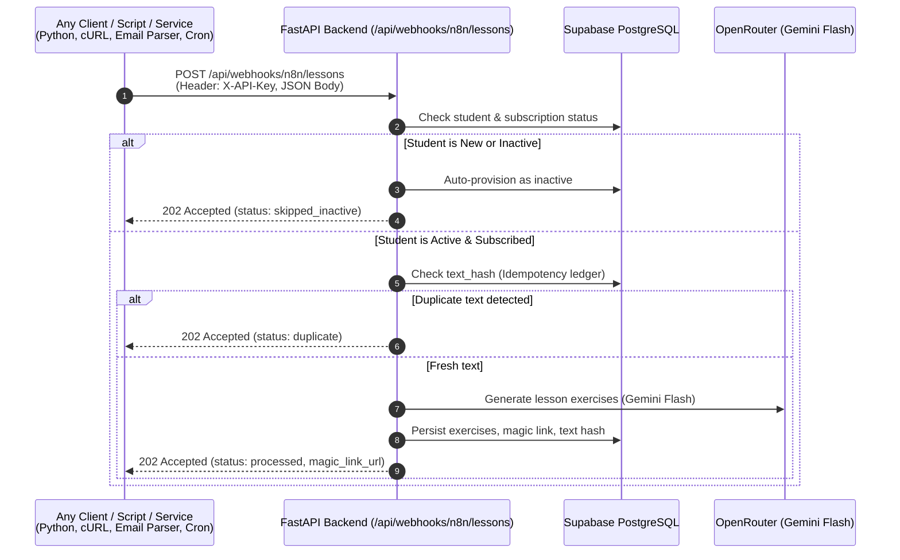

# Exercise Ingestion Webhook Guide

[🏠 Home (README)](../README.md) • [🏗️ Architecture](architecture.md) • [📡 API Reference](api_reference.md) • [🤖 AI Engine](ai_engine.md) • [🗄️ Database](database_schema.md) • [⚙️ Configuration](configuration.md) • [👤 User Management](user_registration.md) • [⚡ Ingestion Webhook](exercises_webhook.md)

---

## 1. Overview: Universal HTTP Ingestion

The platform exposes an HTTP webhook endpoint to ingest raw German theory lessons from **any** upstream service, email parser, automation platform, or custom script:

```http
POST /api/webhooks/n8n/lessons
```

### Decoupled Responsibility Model
* **Upstream Producer (Client / Script / Service):** Extracts or receives the student's email and the raw theoretical lesson text, then sends an authenticated HTTP `POST` request.
* **Backend (`language_exercises`):** Handles student verification, automatic account provisioning, idempotency hashing, sequential lesson numbering, OpenRouter AI exercise generation, Supabase persistence, and capability token issuance.



---

## 2. Webhook Specification

### Endpoint & Headers
* **URL:** `POST http://localhost:8000/api/webhooks/n8n/lessons` (or your production domain)
* **Headers:**
  * `Content-Type: application/json`
  * `X-API-Key: <N8N_API_KEY>` *(Configured in `.env`)*

### Query Parameters
| Parameter | Type | Required | Default | Description |
| :--- | :--- | :--- | :--- | :--- |
| `run_async` | `boolean` | No | `false` | When `true`, delegates lesson generation to FastAPI's background queue and returns immediately (< 50ms). |

### Request Payload (`JSON`)
```json
{
  "email": "student@example.com",
  "course_name": "German Theory",
  "date": "2026-10-30",
  "raw_text": "Heute lernen wir Wechselpräpositionen: an, auf, hinter, in, neben, über, unter, vor, zwischen..."
}
```

| Field | Type | Required | Default | Description |
| :--- | :--- | :--- | :--- | :--- |
| `email` | `string` | **Yes** | — | Recipient student's email address. |
| `course_name` | `string` | No | `"German Theory"` | Course identifier for subscription routing. |
| `date` | `string` | No | Current Date (`YYYY-MM-DD`) | Lesson publication/class date. |
| `raw_text` | `string` | **Yes** | — | Raw body text containing the grammar theory. |

---

## 3. Client Implementation Examples

### 3.1. cURL
```bash
curl -X POST "http://localhost:8000/api/webhooks/n8n/lessons" \
  -H "Content-Type: application/json" \
  -H "X-API-Key: your-internal-secret-key" \
  -d '{
    "email": "luismaiasombra@gmail.com",
    "course_name": "German Theory",
    "raw_text": "Wechselpräpositionen: an, auf, hinter, in, neben, über, unter, vor, zwischen. Akkusativ für Bewegung (Wohin?), Dativ für Position (Wo?)."
  }'
```

### 3.2. Python (`httpx` or `requests`)
```python
import httpx

payload = {
    "email": "luismaiasombra@gmail.com",
    "course_name": "German Theory",
    "raw_text": "Heute besprechen wir die Verben mit festen Präpositionen: warten auf (+Akk), denken an (+Akk)..."
}

headers = {
    "X-API-Key": "your-internal-secret-key",
    "Content-Type": "application/json"
}

response = httpx.post(
    "http://localhost:8000/api/webhooks/n8n/lessons",
    headers=headers,
    json=payload,
    timeout=60.0
)

data = response.json()
print("Status:", data["status"])
if data["status"] == "processed":
    print("Lesson Number:", data["lesson"])
    print("Magic Link URL:", data["magic_link_url"])
```

### 3.3. JavaScript / TypeScript (`fetch`)
```javascript
const response = await fetch("http://localhost:8000/api/webhooks/n8n/lessons", {
  method: "POST",
  headers: {
    "Content-Type": "application/json",
    "X-API-Key": "your-internal-secret-key",
  },
  body: JSON.stringify({
    email: "luismaiasombra@gmail.com",
    course_name: "German Theory",
    raw_text: "Grammar lesson text...",
  }),
});

const result = await response.json();
console.log(result);
```

---

## 4. Response Payloads & Statuses

The webhook always returns HTTP `202 Accepted` when the request format and API key are valid. The payload `status` field indicates the processing outcome:

### 4.1. `status: "processed"`
The lesson was successfully generated and committed to Supabase.
```json
{
  "status": "processed",
  "message": "Lesson 14 successfully generated with 4 exercises.",
  "user_id": "9b1deb4d-3b7d-4bad-9bdd-2b0d7b3dcb6d",
  "lesson": 14,
  "magic_link_token": "u_k91bN568q_Qe-f82L90w...",
  "magic_link_url": "http://localhost:5173/lesson/u_k91bN568q_Qe-f82L90w...",
  "exercise_count": 4
}
```

### 4.2. `status: "skipped_inactive"`
The student is not yet active (`is_active = FALSE`) or has unsubscribed. New students are auto-provisioned as inactive to prevent unauthorized AI token consumption.
```json
{
  "status": "skipped_inactive",
  "message": "User was newly auto-provisioned as inactive. Lesson generation skipped until user is activated.",
  "user_id": "9b1deb4d-3b7d-4bad-9bdd-2b0d7b3dcb6d",
  "lesson": null,
  "magic_link_token": null,
  "magic_link_url": null,
  "exercise_count": null
}
```

### 4.3. `status: "duplicate"`
An identical text hash was already ingested for this student and course. Prevents duplicate lesson numbers and duplicate AI token expenditure.
```json
{
  "status": "duplicate",
  "message": "Duplicate raw text already ingested for this user and course.",
  "user_id": "9b1deb4d-3b7d-4bad-9bdd-2b0d7b3dcb6d",
  "lesson": 14,
  "magic_link_token": null,
  "magic_link_url": null,
  "exercise_count": null
}
```

---

## 5. Synchronous vs. Asynchronous Ingestion

* **Synchronous (Default, `run_async=false`):** The HTTP request blocks until OpenRouter finishes generating the exercises (~2-4 seconds) and returns the generated `magic_link_url` directly in the HTTP response.
* **Asynchronous (`run_async=true`):** Append `?run_async=true` to return `202 Accepted` within 50ms while exercise generation runs in the background.

```http
POST /api/webhooks/n8n/lessons?run_async=true
```

Response:
```json
{
  "status": "accepted",
  "message": "Lesson generation task accepted for student@example.com and queued in background."
}
```

---

## 6. Next Steps & Related Documentation

* [🏗️ System Architecture](architecture.md) — End-to-end data flow and principles.
* [📡 API Reference](api_reference.md) — Complete endpoint documentation.
* [👤 User Management Guide](user_registration.md) — Activating auto-provisioned students.
* [⚙️ Configuration Guide](configuration.md) — Setting `N8N_API_KEY` in `.env`.
